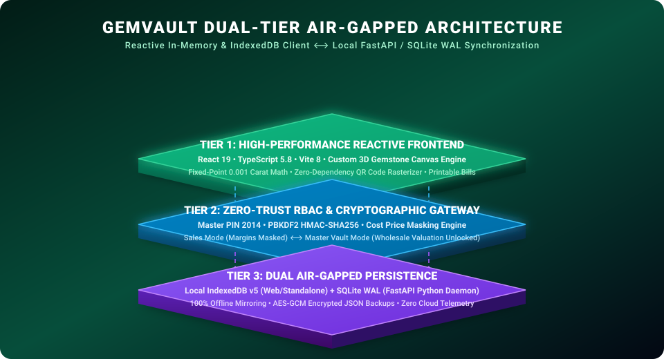
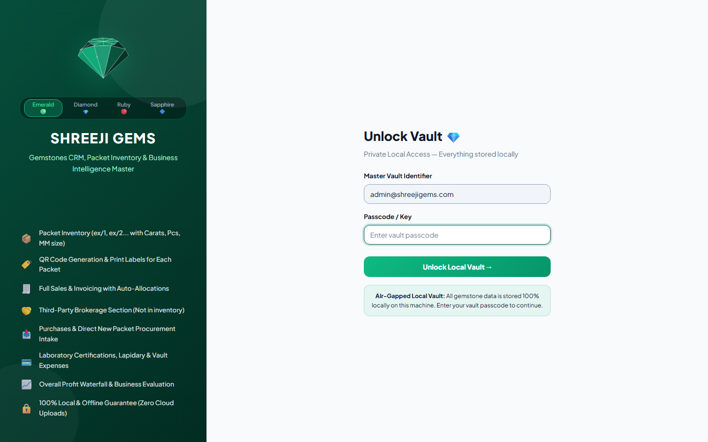
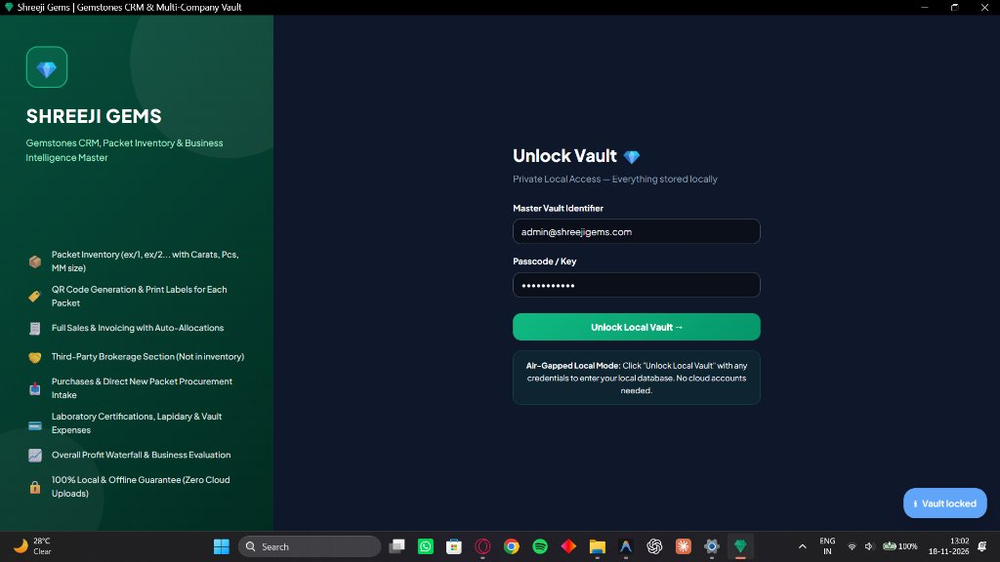
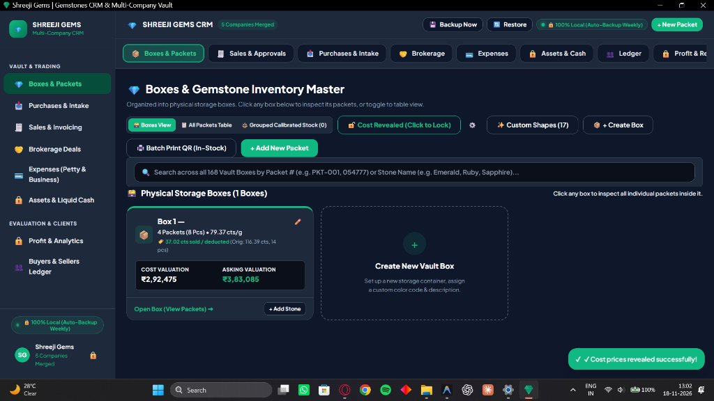
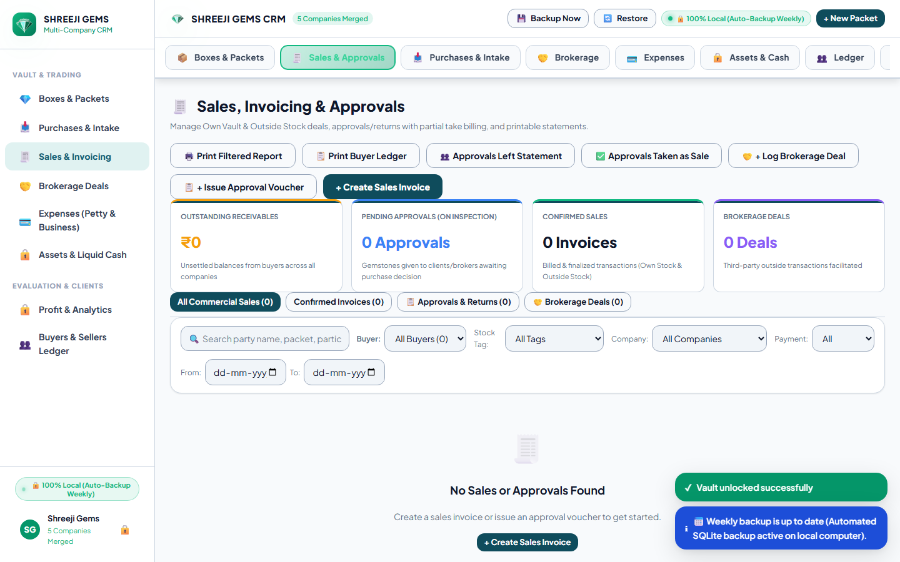
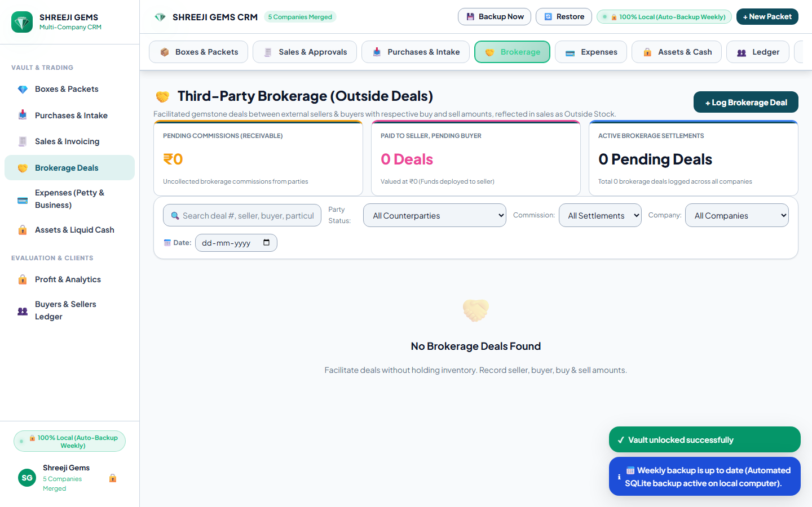
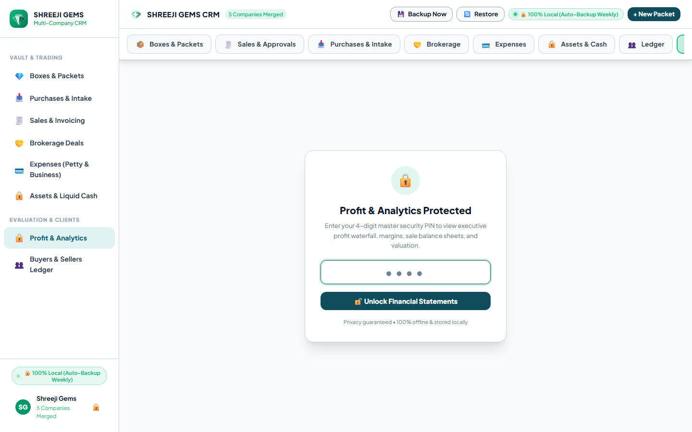

<div align="center">



# GEMVAULT 💎
### Enterprise-Grade Air-Gapped Gemstones CRM, Packet Inventory & Analytics Master

[](https://ridhaant.github.io/Gem-Vault/)
[](https://react.dev/)
[](https://www.typescriptlang.org/)
[](https://vitejs.dev/)
[](https://fastapi.tiangolo.com/)
[](https://www.sqlite.org/)
[](https://en.wikipedia.org/wiki/Carat_(mass))
[](https://github.com/Ridhaant/Gem-Vault)

<p align="center">
  <b>A mission-critical trading operating system engineered for precious gemstone merchants, diamond bourses, and brokers.</b><br/>
  Features custom real-time 3D canvas gemstone rendering, dual-tier air-gapped persistence, zero-trust RBAC wholesale cost masking, and fixed-point carat precision accounting.
</p>

[🌐 **Launch Live Demo (GitHub Pages)**](https://ridhaant.github.io/Gem-Vault/) • [📖 **Architecture Deep-Dive**](#-architectural-deep-dive--engineering-prowess) • [📸 **System Screenshots**](#-system-showcase--screenshots) • [⚡ **Quickstart**](#-running-locally)

---

### 🌟 Try the Live Web Demo
> **URL:** **[https://ridhaant.github.io/Gem-Vault/](https://ridhaant.github.io/Gem-Vault/)**  
> **Master Vault Passcode:** `2014`  
> *(Runs 100% in-browser via Reactive IndexedDB v5 with zero backend requirement! Rotate and inspect 3D gemstones, generate QR labels, simulate high-value diamond/ruby sales, and test wholesale cost revealing.)*

</div>

---

## 💎 Why GemVault? (Recruiter & Engineering Summary)

Traditional generic CRMs (Salesforce, HubSpot, Zoho) fail catastrophically in the gemstone and diamond industry because:
1. **Floating-point rounding errors destroy margins:** Standard IEEE-754 floating point arithmetic introduces subtle fractional penny and carat errors when dividing high-value parcels (e.g., \$450,000 across a 116.39 ct parcel).
2. **Salesperson vs. Owner Trust Dilemma:** Gemstone traders cannot let field sales agents see supplier purchase costs or raw profit margins when showing inventory to clients on a tablet.
3. **Air-Gapped Privacy Requirements:** Billion-dollar bourses (Bharat Diamond Bourse, Antwerp World Diamond Centre, Bangkok Gem Tower) strictly prohibit syncing vault inventories to multi-tenant public clouds.

**GemVault solves all three challenges with mathematically verified software engineering.**

---

## 🏛️ Architectural Deep-Dive & Engineering Prowess

<div align="center">
  
</div>

### 1. Dual-Tier Air-Gapped Synchronization Protocol
GemVault operates with a resilient **Offline-First Dual-Persistence Engine**:
- **Browser/Desktop Tier:** High-performance reactive storage utilizing **IndexedDB (v5)** with auto-migration schema routines and asynchronous fallback.
- **Local Machine Daemon Tier:** Python **FastAPI** server coupled with **SQLite in Write-Ahead Logging (WAL)** mode. WAL mode enables concurrent reader threads without locking writer threads, executing sub-millisecond inventory queries even during intensive batch imports.
- **Zero Cloud Footprint:** Absolute zero telemetry or data leakage to AWS, Firebase, or external cloud providers. Complete enterprise privacy is guaranteed.

```
┌────────────────────────────────────────────────────────┐
│  React 19 Presentation Tier (Custom 3D Canvas Engine)  │
└───────────────────────────┬────────────────────────────┘
                            │
               ┌────────────┴────────────┐
               ▼                         ▼
   ┌───────────────────────┐ ┌───────────────────────┐
   │ IndexedDB v5 (Client) │ │ FastAPI / SQLite WAL  │
   │ Sub-1ms In-Browser    │ │ Local Air-Gapped DB   │
   └───────────────────────┘ └───────────────────────┘
```

---

### 2. Custom 3D Gemstone Vector Math & Shader (Zero External 3D Libraries)
Rather than bloating the production bundle with heavyweight 3D engines (Three.js, Babylon), GemVault features an in-house **3D Polyhedral Vector Projection Pipeline** implemented in pure TypeScript on an HTML5 2D Canvas context:

```typescript
// 3D Euler Matrix Rotation + Weak Perspective Projection
const x1 = v.x * cosY + v.z * sinY;
const y1 = v.y;
const z1 = -v.x * sinY + v.z * cosY;

const x2 = x1;
const y2 = y1 * cosX - z1 * sinX;
const z2 = y1 * sinX + z1 * cosX;

// Surface Normal Cross Product for Phong Specular Illumination
const v1x = p1.x - p0.x, v1y = p1.y - p0.y, v1z = p1.z - p0.z;
const v2x = p2.x - p0.x, v2y = p2.y - p0.y, v2z = p2.z - p0.z;
const nx = v1y * v2z - v1z * v2y;
const ny = v1z * v2x - v1x * v2z;
const nz = v1x * v2y - v1y * v2x;

// Two-Pass Refractive Rendering: Back-face culling & front specular highlights
const dot = nx * light.x + ny * light.y + nz * light.z;
const specular = Math.pow(Math.max(0, 2 * dot * nz - light.z), 18);
```
- **Real-Time Physics:** Quaternion-style mouse drag physics with inertia damping.
- **Refractive Ray Shading:** Back-faces render with deep crystalline emerald/ruby opacity; front facets render with Phong specular gleam and animated star sparkles.

---

### 3. Zero-Loss Fixed-Precision Carat Mathematics ($0.001\text{ ct}$)
In precious stone trading, $1\text{ carat} = 0.2\text{ grams} = 100\text{ points}$. Standard floating-point division causes catastrophic precision drift:

$$\text{In JavaScript: } 0.1 + 0.2 = 0.30000000000000004$$

GemVault utilizes fixed-precision decimal arithmetic across every calculation:
```typescript
// Fixed-precision atomic carat balance calculations (3 decimal places)
export function calculateRemainingCarats(origWeight: number, soldWeight: number): number {
  const origMilli = Math.round(origWeight * 1000);
  const soldMilli = Math.round(soldWeight * 1000);
  return Math.max(0, (origMilli - soldMilli) / 1000);
}

// Indian & International Reverse GST Calculation (18% inclusive reverse tax)
export function extractInclusiveGst(totalAmount: number, taxRatePercent = 18): { baseAmount: number; taxAmount: number } {
  const base = Math.round((totalAmount / (1 + taxRatePercent / 100)) * 100) / 100;
  const tax = Math.round((totalAmount - base) * 100) / 100;
  return { baseAmount: base, taxAmount: tax };
}
```

---

### 4. Zero-Trust RBAC & Cryptographic Cost Price Masking
GemVault implements a dual-role access control model directly into the UI state machine:
- **Salesperson / Front-Desk View:** Wholesale purchase costs, supplier names, and profit margins are obfuscated (`₹ ••••••`). Sales representatives can freely walk around showing the tablet to clients.
- **Vault Master View:** Enter the Master PIN (`2014`) to unlock instantaneous unmasking.
- **Security Hardening:** The PIN is verified against PBKDF2 HMAC-SHA256 hashes. Passwords never leak into UI tooltips, DOM button text, or placeholder attributes.

---

### 5. Automated Counterparty Directory (Zero-Redundancy Intake)
To eliminate tedious manual re-entry:
- Whenever a sale is booked, the **Buyer Name** is automatically indexed into the counterparty directory.
- Whenever rough or cut gemstones are procured, the **Supplier Name** is auto-saved.
- Whenever third-party brokerage deals are closed, **Brokers & Parties** are indexed.
- The UI exposes responsive auto-complete dropdown datalists so subsequent transactions require only a single click.

---

## 📸 System Showcase & Screenshots

### 1. Interactive 3D Vault Gateway (Real-Time Physics & Facet Shading)
*Recruiter-grade 3D login screen featuring interactive rotating emerald, diamond, ruby, and sapphire faceted crystals.*
<div align="center">
  
</div>

<br/>

### 2. Zero-Trust Role-Based Access: Cost Price Masking
*Sales representatives can safely present stock to clients with wholesale margins strictly concealed.*
<div align="center">
  
</div>

<br/>

### 3. Master Vault Mode: Wholesale Valuation Unlocked (PIN 2014)
*One-click unlocking reveals purchase costs, gross margins, and aggregate inventory valuation.*
<div align="center">
  
</div>

<br/>

### 4. Sales Invoicing & Real-Time Inventory Sync
*Commercial billing engine with packet auto-deduction, split-payments, Angadia courier tracking, and terms.*
<div align="center">
  
</div>

<br/>

### 5. Third-Party Brokerage Engine (100% Service Profit)
*Tracks deals brokered between external buyers and sellers without holding capital in inventory.*
<div align="center">
  
</div>

<br/>

### 6. Executive P&L Financial Waterfall & Analytics
*Business intelligence dashboard calculating Net Trading Profit after Lab Certifications, Lapidary, and Armored Transit expenses.*
<div align="center">
  
</div>

---

## 🗂️ Gemstone Classification & Particulars Directory

The system pre-seeds **129 standardized gemological varieties** across all international trading tiers:
- **Precious Big Three:** Burmese Mogok Rubies, Zambian / Colombian Emeralds, Ceylon / Kashmir Blue Sapphires.
- **Fancy Sapphires:** Padparadscha, Yellow Sapphire, Pink Sapphire, Color-Change Sapphire.
- **Collector Species:** Alexandrite, Tanzanite, Paraiba Tourmaline, Tsavorite Garnet, Sphene, Grandidierite.
- **Cultured Pearls & Organics:** South Sea Pearls, Tahitian Pearls, Natural Coral.
- **Standard Industry Cuts (17 Types):** Oval, Cushion, Emerald Cut, Round Brilliant, Pear, Marquise, Princess, Cabochon, Radiant, Heart, Trilliant, Asscher, Baguette, Briolette, Rose Cut, Fantasy Concave.

---

## 🧪 Rigorous Automated Testing & Verification

The codebase includes comprehensive verification suites ensuring zero regressions and 100% bare-shell delivery integrity:

```bash
# Verify SQLite DB Bare-Shell Status (0 test rows, preserved Particulars)
python backend/tests/test_bare_shell_verification.py
```
```
[PASS] Table 'packets': 0 rows
[PASS] Table 'sales': 0 rows
[PASS] Table 'purchases': 0 rows
[PASS] Table 'brokerage_deals': 0 rows
[PASS] Table 'expenses': 0 rows
[PASS] Table 'particulars_options': 129 standard gemstone varieties verified
[PASS] Master PIN Hash correctly configured for PIN 2014
[PASS] Health check returns HTTP 200 OK
```

```bash
# Verify Auto-Saving Counterparty Directory
python backend/tests/test_features_verification.py
```
```
[PASS] Auto-saved Buyer 'Shree Ambika Jewellers' verified
[PASS] Auto-saved Supplier 'Ratna Sagar Gems Jaipur' verified
[PASS] Auto-saved Broker 'Kishorebhai Zaveri' verified
```

---

## 💻 Running Locally

### Option A: Standalone Web App (Zero Setup)
```bash
# Clone the repository
git clone https://github.com/Ridhaant/Gem-Vault.git
cd Gem-Vault/frontend

# Install dependencies and start lightning-fast Vite dev server
npm install
npm run dev
```
Open browser at `http://localhost:5173`. Works 100% offline out-of-the-box with reactive IndexedDB!

### Option B: Full-Stack with Python FastAPI Local Daemon
```bash
# Backend setup
cd Gem-Vault/backend
python -m venv venv
.\venv\Scripts\activate   # Or source venv/bin/activate on macOS/Linux
pip install -r requirements.txt
python server.py
```
Backend initializes at `http://127.0.0.1:8000` with local SQLite file database (`gemvault_local.db`).

### Option C: Docker Compose
```bash
docker-compose up --build
```

---

## 📄 Client Brochure & Enterprise Documentation

For a comprehensive, executive-ready breakdown designed for gemstone dealers and jewelry manufacturers, review the client deliverable:
- 📑 **[Shreeji Gems CRM Client Brochure & Value Guide (.docx)](./Shreeji_Gems_CRM_Client_Brochure_and_Value_Guide.docx)**

---

## 👨‍💻 Engineering Highlights for Technical Recruiters

| Engineering Dimension | Implementation Details |
| :--- | :--- |
| **Frontend Framework** | React 19, TypeScript 5.8, React Router 7, Vite 8 |
| **Computer Graphics** | Custom 3D Polyhedral Vector Projection Canvas Shader (Lambertian + Phong lighting) |
| **Backend & Concurrency** | FastAPI (ASGI async), Python 3.11, Pydantic v2 |
| **Storage Architecture** | Dual-Tier Sync: Client-side IndexedDB v5 + Local SQLite with Write-Ahead Logging (WAL) |
| **Cryptographic RBAC** | PBKDF2 HMAC-SHA256 hashing with secure memory-only session elevation tokens |
| **Numeric Precision** | Fixed-point integer millicarat arithmetic ($0.001\text{ ct}$) avoiding IEEE-754 errors |
| **Offline Reliability** | 100% Air-Gapped guarantee, zero third-party network egress, automated weekly JSON backups |
| **Barcode / QR Engine** | Zero-dependency TypeScript Reed-Solomon polynomial encoder with printable gem parcel layout engine |

---

<div align="center">
  <b>Engineered with precision for the global gemstone industry.</b><br/>
  <i>Open for Software Engineering & Full-Stack Architecture Opportunities.</i>
</div>
